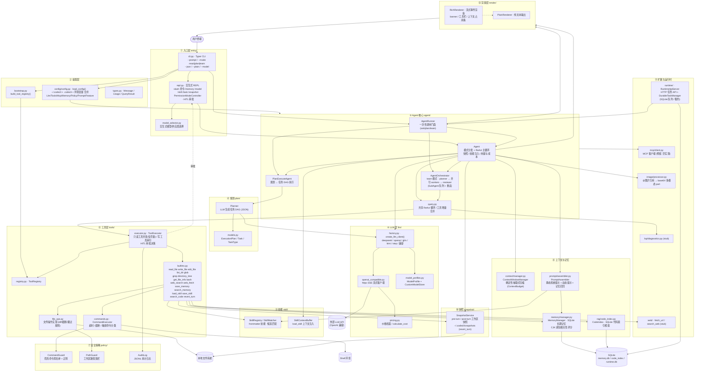
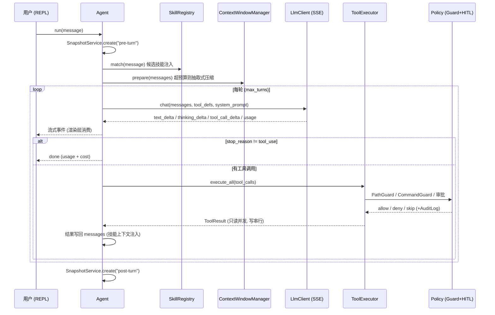

# CodeAgent (codecli) 架构图

> Python 3.13 · typer + prompt-toolkit + rich + httpx + pillow
> 入口：`codecli` 命令（`codecli.entry.cli:app`）

## 1. 总体分层架构

## 2. ReAct 主循环（agent/agent.py + agent/query.py）

## 3. 三种 Agent 模式

| 模式 | 实现 | 流程 |
|------|------|------|
| `react`（默认） | `Agent._run_react` / `query.query` | 标准 ReAct 循环：思考 → 工具 → 观察，直到模型停止 |
| `plan` | `PlanExecuteAgent` + `plan/Planner` | LLM 生成任务 DAG（JSON）→ 按依赖顺序执行任务 → 汇总 |
| `team` | `AgentOrchestrator` | planner 子代理出计划 → worker 队列并行执行步骤（可重试）→ reviewer 复核 |

## 4. 模块职责速查

| 模块 | 职责 |
|------|------|
| `entry/` | Typer CLI、REPL 循环、slash 命令、权限模式、模型选择 |
| `bootstrap.py` | 组装 ToolRegistry（内置工具 + MCP 预留） |
| `config/` | 三层配置合并：用户级 → 项目级 → 环境变量 |
| `agent/` | Agent / AgentRunner / PlanExecuteAgent / AgentOrchestrator / query |
| `plan/` | LLM 任务规划器与 ExecutionPlan 模型 |
| `llm/` | LLM 协议、多供应商工厂、SSE 流式客户端、模型档案、计价 |
| `tools/` | 工具定义/注册/执行、内置工具、文件操作、命令执行 |
| `policy/` | 命令守卫、路径守卫、审计日志（HITL 前置拦截） |
| `context/` | 上下文窗口预算与确定性历史压缩 |
| `memory/` | SQLite 长期记忆（存取 + 相关性召回） |
| `rag/` | 本地代码索引检索（search_code 工具后端） |
| `prompt/` | 系统提示静态/动态装配、记忆召回注入 |
| `skill/` | 技能注册/匹配/加载（frontmatter 文件） |
| `snapshot/` | 轮次前后工作区快照与回滚 |
| `mcp/` | MCP 客户端（预留，当前为空实现） |
| `runtime/` | HTTP 任务 API 服务 + SQLite 持久任务队列 |
| `image/` | 图片引用解析为多模态消息 |
| `web/` `lsp/` | 网络/诊断 stub |
| `render/` | rich / plain 双渲染器，消费流式事件 |

## 5. 外部依赖

- **运行时**：typer（CLI）、prompt-toolkit（REPL）、rich（渲染）、httpx（LLM HTTP/SSE）、pillow（图片）、sqlite3（记忆/索引/任务队列）
- **外部服务**：任意 OpenAI 兼容 LLM API（deepseek / openai / glm / kimi / step / 自定义 base_url）
- **本地状态目录**：`~/.codecli/`（config、memory.db、snapshots、runtime.db、技能）

## 备注（代码现状）

- `src/codecli/__main__.py` 中 `from entry.cli import app` 缺少 `codecli.` 前缀，直接 `python -m codecli` 会导入失败（console script 入口不受影响）。
- `mcp/client.py` 为 0 字节空文件，MCP 能力尚未实现（bootstrap 返回 `None` manager）。
- `config.py`（包根）与 `config/config.py` 内容重复，存在双份配置实现。
- `web/` 与 `lsp/` 目前是 stub。
